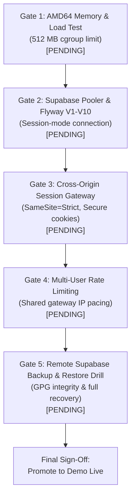

# Switchly — Zero-Budget Free-Tier Deployment Plan (FROZEN)

> **Status: ARCHITECTURE FROZEN — READY FOR ₹0 DEMO DEPLOYMENT (Cloud Verification Gates Pending)**  
> Target Infrastructure Cost: ₹0 / month  
> Target Architecture: Render Free (`switchly-api`, AMD64) + Render Free (`switchly-web`, AMD64) + Supabase Free (PostgreSQL)  
> Document Version: 3.0 (Architecture Baseline Frozen)  
> Scope: Public demonstration & evaluation only (Not an enterprise high-availability production architecture)

---

## 1. Architecture & Service-to-Host Mapping

```
                                    Public Internet / Client Browsers
                                                   │
                                                   │ HTTPS (Port 443, Render TLS termination)
                                                   ▼
                                     ┌───────────────────────────┐
                                     │    Render Free Web Svc    │
                                     │       switchly-web        │
                                     │   Node 24 Gateway + SPA   │
                                     │  switchly-web.onrender.com│
                                     └─────────────┬─────────────┘
                                                   │
                                                   │ Server-to-Server HTTPS
                                                   │ API_ORIGIN: https://switchly-api.onrender.com
                                                   ▼
┌─────────────────────────────────┐  ┌───────────────────────────┐
│     Customer Backend Apps       │  │    Render Free Web Svc    │
│    (SDK Evaluation Clients)     │─▶│       switchly-api        │
│    POST /api/v1/evaluate        │  │    Spring Boot 4 / JRE 21 │
│  Authorization: SDK swk_...     │  │  switchly-api.onrender.com│
└─────────────────────────────────┘  └─────────────┬─────────────┘
                                                   │
                                                   │ JDBC over TLS (sslmode=require)
                                                   │ Supavisor Session Pooler (IPv4)
                                                   │ Port 5432 (Full advisory lock support)
                                                   ▼
                                     ┌───────────────────────────┐
                                     │    Supabase Free Project  │
                                     │   PostgreSQL (15, 16, 17) │
                                     │ aws-0-<region>.pooler...  │
                                     │ 60 direct DB conns /      │
                                     │ 200 pooler client conns   │
                                     │       500 MB Storage      │
                                     └───────────────────────────┘
```

### Component Details

| Service | Platform / Host | Tier Specifications | Role & Runtime Boundary |
|---|---|---|---|
| `switchly-api` | Render Web Service (Docker runtime) | AMD64 (x86_64), 0.1 vCPU, 512 MB RAM, spins down after 15 min idle | Spring Boot 4 REST API, Flyway V1–V10 migrations, JWT verification, feature evaluation engine. |
| `switchly-web` | Render Web Service (Docker runtime) | AMD64 (x86_64), 0.1 vCPU, 512 MB RAM, spins down after 15 min idle | Static host for React 19 SPA + Node.js same-origin session gateway (`web/server/gateway.mjs`), HttpOnly cookie issuance, token refresh. |
| `switchly-db` | Supabase Free Project (Nano compute) | Shared CPU, 500 MB storage, PostgreSQL (15+), 60 PostgreSQL backend connections, 200 pooler client connections (default pool size: 15) | Relational persistence, Flyway schema history, tenant data, flags, and targeting rules. |

---

## 2. Technical Corrections & Source Verifications

### 2.1 — Supabase Connection Mode, Pooler Username & Connection Limits

- **Network Boundary (IPv4 vs. IPv6):** Render free-tier container instances operate on an IPv4-only egress network. Supabase direct connections (`db.<project-ref>.supabase.co:5432`) resolve to IPv6 on the free tier and will fail to connect from Render without Supabase's paid IPv4 add-on.
- **Session-Mode Pooler Required:** Supabase provides an IPv4-accessible shared pooler (Supavisor). To support Flyway database migrations, **session mode (port 5432)** must be used. Transaction mode (port 6543) breaks Flyway because transactional connection multiplexing drops PostgreSQL session-level advisory locks (`pg_advisory_lock`), causing migration locks to fail or hang.
- **Custom Role Pooler Username:** When connecting through Supavisor with a custom database role (such as `switchly_app`), the username format required by Supavisor is:
  $$\text{Username} = \texttt{switchly\_app.<project-ref>}$$
  *(Do not use `postgres.<project-ref>` when connecting as `switchly_app`)*.
- **Dashboard Hostname:** The exact pooler hostname (e.g., `aws-0-<region>.pooler.supabase.com`) varies depending on the region selected at project creation. **Never guess or invent the pooler hostname.** Copy it verbatim from the Supabase Dashboard:
  `Project Settings` $\rightarrow$ `Database` $\rightarrow$ `Connection String` $\rightarrow$ `Session pooler`.
- **Connection Limits & Semantics (Free / Nano Tier):**
  - **PostgreSQL Backend Connection Limit:** **60 maximum connections** directly on the database engine.
  - **Shared Pooler Client Connection Limit:** **200 maximum client connections** accepted by the Supavisor pooler proxy.
  - **Default Pool Size:** **15 backend connections** allocated to the pooler for dispatching queries to PostgreSQL.
  - **Distinction:** *Pooler client connections* represent TCP connections from application clients (e.g., HikariCP) to Supavisor. *Backend connections* represent actual worker processes running on the PostgreSQL database server. With Switchly's `DB_POOL_MAX_SIZE=3`, the API acquires at most 3 client connections against Supavisor, remaining well within the 200 client connection ceiling and the 15 backend connection pool size.

### 2.2 — Database Roles, Privileges, and Unified Spring Datasource

#### Permission Model Realities
- **Role Authority:** Granting `CREATE ON SCHEMA public` and assigning table ownership to `switchly_app` means `switchly_app` has full DDL privileges (including `CREATE TABLE`, `ALTER TABLE`, and `DROP TABLE`). It is **not** a read/write-only runtime role.
- **Single Datasource in Switchly:** Inspection of `api/src/main/resources/application.yaml` demonstrates that Switchly configures only a single unified datasource:
  ```yaml
  datasource:
    url: ${SPRING_DATASOURCE_URL:jdbc:postgresql://localhost:15432/switchly}
    username: ${SPRING_DATASOURCE_USERNAME:switchly}
    password: ${SPRING_DATASOURCE_PASSWORD:switchly}
  flyway:
    enabled: true
    baseline-on-migrate: false
    locations: classpath:db/migration
  ```
  Switchly does not configure `spring.flyway.user` or a separate migration datasource. Modifying Java configuration classes or application properties is prohibited by the change freeze. Therefore, `switchly_app` serves as the **unified migration and runtime role**.
- **`ALTER DEFAULT PRIVILEGES` Behavior:** In PostgreSQL, `ALTER DEFAULT PRIVILEGES` executed by the `postgres` administrative user only affects objects subsequently created by `postgres`. It has **no effect** on tables created by `switchly_app`. Because `switchly_app` runs the Flyway migrations directly, `switchly_app` automatically owns every table and index it creates.
- **Requirement of an Empty Schema:** Initial Flyway migrations (`V1..V10`) require a completely clean, empty `public` schema. Pre-existing tables or partial schemas from earlier experiments will cause migration failures.

#### SQL Setup Script for Supabase SQL Editor
Execute the following script once as the administrative `postgres` user in the Supabase Dashboard SQL Editor:

```sql
-- 1. Create dedicated application role
CREATE ROLE switchly_app WITH LOGIN NOSUPERUSER NOCREATEDB NOCREATEROLE NOREPLICATION
  PASSWORD '<generate-secure-random-password>';

-- 2. Database connection grant
GRANT CONNECT, TEMPORARY ON DATABASE postgres TO switchly_app;

-- 3. Schema grants: USAGE (for runtime queries) and CREATE (for Flyway DDL execution)
GRANT USAGE, CREATE ON SCHEMA public TO switchly_app;

-- NOTE: If the public schema is not fresh, clean it prior to migration.
-- Note that an 'ALTER TABLE ... OWNER TO' loop only transfers table ownership;
-- it does not alter sequences, views, types, routines, or domain ownership.
-- Therefore, an empty public schema is strictly required before Flyway executes.
```

### 2.3 — Evaluation API Specification (Verified Against Java Source)

The evaluation endpoint implementation was verified directly in `api/src/main/java/live/switchly/api/controller/EvaluationController.java` and `SdkAuthenticationFilter.java`:

- **Endpoint & Method:** `POST /api/v1/evaluate` (Single flag evaluation) or `POST /api/v1/evaluate/batch` (Batch evaluation up to 100 flags).
- **HTTP Method:** `POST` only (`GET` is not supported and returns `405 Method Not Allowed`).
- **Authorization Header:** `Authorization: SDK swk_<43-characters>` (Regex: `^SDK swk_[A-Za-z0-9_-]{43}$`). The prefix is strictly `SDK `, not `Bearer `.
- **Environment Selection:** Environment is selected via the `"environmentKey"` field inside the JSON request body. The SDK key must have an active grant for this environment in `sdk_key_environments`.
- **Request Body Contract:**
  ```json
  {
    "projectKey": "p-demo-project",
    "environmentKey": "development",
    "flagKey": "new-checkout-flow",
    "context": {
      "userId": "usr_94821",
      "country": "US",
      "custom": {
        "tier": "premium",
        "betaTester": true
      }
    }
  }
  ```
- **Response Contract (HTTP 200):**
  ```json
  {
    "flagKey": "new-checkout-flow",
    "environmentKey": "development",
    "valueType": "BOOLEAN",
    "value": true,
    "enabled": true,
    "reason": "TARGETING_MATCH",
    "evaluatedAt": "2026-11-22T16:45:00.000Z"
  }
  ```

### 2.4 — Gateway CSRF & Session Architecture

Verified directly in `web/server/gateway.mjs` and `web/src/api.ts`:
- **CSRF Token Header:** `X-Switchly-Request: console`.
  `web/src/api.ts` line 22 attaches `"X-Switchly-Request": "console"` to every fetch request.
  `web/server/gateway.mjs` lines 122–123 strictly rejects non-GET requests where `x-switchly-request !== "console"` or `sec-fetch-site === "cross-site"` with HTTP 403.
- **Session Cookie:** `switchly_session=<uuid>; Path=/; HttpOnly; SameSite=Strict; Max-Age=604800`.
- **HTTPS Secure Flag:** In `web/server/index.mjs`, `secure` is enabled if `(COOKIE_SECURE !== "false" && NODE_ENV === "production") || COOKIE_SECURE === "true"`. Setting `COOKIE_SECURE=true` and `NODE_ENV=production` guarantees that the `Secure` attribute is attached on Render's HTTPS domain.
- **Same-Origin Translation:** The browser only connects to `switchly-web.onrender.com`. Backend JWT access tokens and refresh tokens are stored in the Node.js gateway process memory and never disclosed to the browser client.

### 2.5 — Proxy Headers and Rate-Limiting Behavior

Verified in `api/src/main/java/live/switchly/api/security/RateLimiterService.java`:
```java
public String resolveClientIp(HttpServletRequest request) {
    String remoteAddr = request.getRemoteAddr();
    List<String> trusted = properties.getTrustedProxies();
    if (trusted != null && !trusted.isEmpty() && remoteAddr != null && trusted.contains(remoteAddr)) {
        String xff = request.getHeader("X-Forwarded-For");
        if (StringUtils.hasText(xff)) {
            String[] parts = xff.split(",");
            for (String part : parts) {
                String candidate = part.trim();
                if (!candidate.isEmpty()) {
                    return candidate;
                }
            }
        }
    }
    return remoteAddr != null ? remoteAddr : "unknown";
}
```

#### Shared Ingress IP Impact
1. `switchly-web` proxies console API calls over server-to-server HTTPS to `switchly-api`.
2. If `SWITCHLY_TRUSTED_PROXIES` is left empty, `RateLimiterService` uses `request.getRemoteAddr()`.
3. Because all web console requests originate from the Node gateway (or Render's egress NAT proxy), all console users share the same apparent IP address for authentication endpoints!
4. **Endpoint Limits:**
   - Login: 5 requests / 60 seconds per IP (`SWITCHLY_RATE_LIMIT_LOGIN_LIMIT`).
   - Register: 3 requests / 60 seconds per IP (`SWITCHLY_RATE_LIMIT_REGISTER_LIMIT`).
   - Refresh: 10 requests / 60 seconds per IP (`SWITCHLY_RATE_LIMIT_REFRESH_LIMIT`).
   - Evaluation: 600 requests / 60 seconds per IP (`SWITCHLY_RATE_LIMIT_EVALUATION_LIMIT`).
5. **Security Rule:** Never set `SWITCHLY_TRUSTED_PROXIES` to a wildcard or untrusted IP. Arbitrary `X-Forwarded-For` headers must not be trusted unless the immediate upstream remote address is explicitly listed. For free-tier demo usage, leave `SWITCHLY_TRUSTED_PROXIES` empty, and verify multi-user login pacing in the acceptance drill.

### 2.6 — JVM Memory Limits (ARM64 Rehearsal vs. AMD64 Cloud Reality)

- **ARM64 Local Empirical Result:** Tested `switchly-api:latest` with `--memory=512m --memory-swap=512m` on Docker Desktop (Apple Silicon ARM64). With `-XX:MaxRAMPercentage=55.0 -XX:MaxMetaspaceSize=128m -XX:ReservedCodeCacheSize=64m`, the idle process stabilized at **349.6 MiB RSS** (68.2% of 512 MB). Startup time was 2.85 seconds. No OOM kill occurred (`OOMKilled=false`).
- **AMD64 Cloud Reality:** Render's free tier runs on AMD64 hardware. JRE memory layouts, compiled code footprints, and pointer sizes on AMD64 differ slightly from ARM64. Furthermore, steady-state idle RSS does not represent peak load RSS.
- **Estimated Peak RSS:** Under active request load (JSON deserialization, Hikari connection threads, Jackson node allocation), RSS is projected to reach **380–420 MiB**. While within 512 MB, this leaves an operational safety margin of ~90–130 MiB.
- **Status:** *Conditionally Feasible*. Conclusive verification requires executing the AMD64 512 MB load test specified in Gate 1.

### 2.7 — Render Free-Hour Accounting (No Artificial Keep-Alives)

Render allocates **750 free instance hours per calendar month per workspace**.

- **Concurrent Consumption:** Instance hours are consumed on a per-service basis. If both `switchly-api` and `switchly-web` run simultaneously for 1 clock hour, they consume **2 instance hours**.
- **24/7 Running Math:**
  $$2 \text{ services} \times 24 \text{ hours/day} \times 31 \text{ days} = 1,488 \text{ instance hours}$$
  Attempting to run both services 24/7 exhausts the 750-hour allowance in **15.6 days**, after which all services in the workspace are suspended for the remainder of the month.
- **Spin-Down & Idling:** Render Free services automatically spin down after 15 minutes without inbound HTTP requests.
- **Permissible Active Window:** To stay within 750 instance hours across a 30-day month:
  $$\frac{750 \text{ hours}}{30 \text{ days} \times 2 \text{ services}} = 12.5 \text{ hours/day per service}$$
  Both services may run concurrently for up to **10–12 active hours per day**.
- **Strict Prohibition on Keep-Alive Pings:** Automated pings, uptime monitors, or cron jobs that artificially keep services awake are strictly prohibited. The deployment must accept idle spin-down.

### 2.8 — Cold-Start Behavior

| Event | Sequence & Typical Latency | User Experience |
|---|---|---|
| `switchly-web` wakeup | Container start + Node.js initialization (5–12 s) | Browser loads initial HTML/CSS skeleton. |
| `switchly-api` wakeup | Container provision + JVM boot + Hikari pool + Flyway validation (25–45 s) | Console shows loading indicator on API calls. |
| Combined cold login | Both services spin up sequentially (40–60 s total) | Initial sign-in will take up to 1 minute. |
| Session loss on web restart | Node gateway memory reset on spin-down | When `switchly-web` spins down after 15 min idle, active sessions are discarded. Users must re-authenticate. |
| Database sleep / pause | Supabase pauses projects after 7 days of inactivity | If paused, first request fails until project is unpaused via Supabase dashboard. |

---

## 3. Environment Variables & Secret Manifest

### 3.1 — `switchly-api` (Render Free Web Service)

| Environment Variable | Source / Value | Classification | Verified Against Source |
|---|---|---|---|
| `PORT` | Auto-injected by Render (default 10000) | System | `application.yaml` reads `${PORT:8080}` |
| `SPRING_PROFILES_ACTIVE` | `prod` | Public | Selects production profile settings |
| `SPRING_DATASOURCE_URL` | `jdbc:postgresql://<pooler-host>:5432/postgres?sslmode=require` | Public / Config | `application.yaml` (`${SPRING_DATASOURCE_URL}`) |
| `SPRING_DATASOURCE_USERNAME` | `switchly_app.<project-ref>` | Public / Config | `application.yaml` (`${SPRING_DATASOURCE_USERNAME}`) |
| `SPRING_DATASOURCE_PASSWORD` | `<switchly_app password>` | **Secret** | `application.yaml` (`${SPRING_DATASOURCE_PASSWORD}`) |
| `SWITCHLY_JWT_SECRET` | 64-character hex string (`openssl rand -hex 32`) | **Secret** | `application.yaml` (`${SWITCHLY_JWT_SECRET:}`) |
| `JAVA_TOOL_OPTIONS` | `-XX:+UseContainerSupport -XX:MaxRAMPercentage=55.0 -XX:InitialRAMPercentage=30.0 -XX:MaxMetaspaceSize=128m -XX:ReservedCodeCacheSize=64m -XX:+ExitOnOutOfMemoryError -Djava.security.egd=file:/dev/./urandom` | Public / JVM | OpenJDK 21 container cgroup detection |
| `DB_POOL_MAX_SIZE` | `3` | Public | `application.yaml` (`hikari.maximum-pool-size: ${DB_POOL_MAX_SIZE:10}`) |
| `DB_POOL_MIN_IDLE` | `1` | Public | `application.yaml` (`hikari.minimum-idle: ${DB_POOL_MIN_IDLE:2}`) |
| `SWITCHLY_CORS_ALLOWED_ORIGINS` | `https://switchly-web.onrender.com` | Public | `CorsProperties.java` (`switchly.cors.allowed-origins`) |
| `SWITCHLY_RATE_LIMIT_ENABLED` | `true` | Public | `RateLimitProperties.java` |
| `SWITCHLY_TRUSTED_PROXIES` | *(leave empty)* | Public | Prevents spoofed client IP evaluation |

### 3.2 — `switchly-web` (Render Free Web Service)

| Environment Variable | Source / Value | Classification | Verified Against Source |
|---|---|---|---|
| `PORT` | Auto-injected by Render | System | `server/index.mjs` reads `process.env.PORT \|\| 3000` |
| `HOST` | `0.0.0.0` | Public | `web/Dockerfile` sets `ENV HOST=0.0.0.0`; required for container binding |
| `NODE_ENV` | `production` | Public | Enables Vite production static file serving and strict cookie modes |
| `COOKIE_SECURE` | `true` | Public | `server/index.mjs` applies `Secure;` flag to session cookie |
| `API_ORIGIN` | `https://switchly-api.onrender.com` | Public / Config | `web/server/gateway.mjs` (`createGateway({ origin })`) |
| `OLLAMA_ORIGIN` | `""` *(empty string)* | Public | `web/server/draft.mjs` resolves to default; gracefully returns 503 if unreachable |

---

## 4. Build Configuration & Docker Contexts

Both services deploy from the single repository using Render's Docker runtime:

| Setting | `switchly-api` | `switchly-web` |
|---|---|---|
| **Root Directory** | `api` | `web` |
| **Dockerfile Path** | `Dockerfile` | `Dockerfile` |
| **Build Context** | `.` | `.` |
| **Builder Architecture** | AMD64 (Render standard) | AMD64 (Render standard) |
| **Health Check Path** | `/healthz` | `/` |

> **Directory Resolution Rule:** When Render's **Root Directory** is configured to a subdirectory (`api` or `web`), all subsequent Docker paths are evaluated relative to that root. Therefore, **Dockerfile Path** must be set to `Dockerfile` and **Build Context** must be `.` (the root directory itself). Setting `api/Dockerfile` or `web/Dockerfile` with a non-empty Root Directory will cause a build failure on Render.

- **API Build Verification:** `api/Dockerfile` builds using `eclipse-temurin:21-jdk` and runs on `eclipse-temurin:21-jre`. `JAVA_TOOL_OPTIONS` is automatically evaluated by the OpenJDK entrypoint.
- **Web Build Verification:** `web/Dockerfile` builds using `node:24-alpine` (`npm ci && npm run build`) and serves via `node server/index.mjs`.

---

## 5. Authenticated Backup & Recovery Procedure

> [!IMPORTANT]
> Supabase Free does not provide automated backups or Point-in-Time Recovery (PITR). Logical backups must be taken manually.
> The previous local restore drill verified SQL restore mechanics into Docker PostgreSQL; it did not test Supabase remote network latency or remote restore limits.

### 5.1 — Authenticated Encrypted Backup Runbook

Logical dumps are exported via the session-mode pooler and encrypted using symmetric authenticated GPG (AES-256) with loopback pinentry:

```bash
#!/usr/bin/env bash
set -euo pipefail

BACKUP_DIR="./backups"
TIMESTAMP="$(date +%Y%m%d_%H%M%S)"
DUMP_FILE="${BACKUP_DIR}/switchly_${TIMESTAMP}.dump"
ENC_FILE="${DUMP_FILE}.gpg"
CHECKSUM_FILE="${ENC_FILE}.sha256"

mkdir -p "${BACKUP_DIR}"
chmod 700 "${BACKUP_DIR}"

echo "1. Exporting custom-format PostgreSQL dump via session pooler..."
pg_dump \
  --dbname="postgresql://switchly_app.<project-ref>@aws-0-<region>.pooler.supabase.com:5432/postgres?sslmode=require" \
  --format=custom \
  --no-owner \
  --no-privileges \
  --file="${DUMP_FILE}"

echo "2. Encrypting archive with symmetric GPG (AES-256)..."
# Loopback pinentry and matching batch options verified locally with GPG 2.x
gpg --symmetric --cipher-algo AES256 --batch --yes --pinentry-mode loopback \
  --passphrase-file <(printf '%s' "${BACKUP_PASSPHRASE:?Must set BACKUP_PASSPHRASE}") \
  --output "${ENC_FILE}" "${DUMP_FILE}"

# Remove plain dump immediately
rm -f "${DUMP_FILE}"

echo "3. Generating SHA-256 checksum manifest..."
(cd "${BACKUP_DIR}" && sha256sum "$(basename "${ENC_FILE}")" > "$(basename "${CHECKSUM_FILE}")")

echo "Backup complete: ${ENC_FILE}"
cat "${CHECKSUM_FILE}"
```

**Destination:** Store the `.gpg` file and `.sha256` manifest in an encrypted external storage location or dedicated secure object store. *Do not commit database dumps to private Git repositories (Git history bloating, credential exposure risks).*

### 5.2 — Disaster Recovery & Role Recreation Runbook

To restore into a fresh Supabase project with an empty application schema:

```bash
#!/usr/bin/env bash
set -euo pipefail

ENC_FILE="$1"
BACKUP_DIR="$(dirname "${ENC_FILE}")"
ENC_BASE="$(basename "${ENC_FILE}")"
CHECKSUM_BASE="${ENC_BASE}.sha256"
RESTORE_FILE="${BACKUP_DIR}/${ENC_BASE%.gpg}"

# 1. Verify integrity inside the backup directory before decryption
echo "1. Verifying SHA-256 checksum inside backup directory..."
(cd "${BACKUP_DIR}" && sha256sum -c "${CHECKSUM_BASE}")

# 2. Decrypt using identical loopback and batch parameters
echo "2. Decrypting backup archive..."
gpg --decrypt --batch --yes --pinentry-mode loopback \
  --passphrase-file <(printf '%s' "${BACKUP_PASSPHRASE:?Must set BACKUP_PASSPHRASE}") \
  --output "${RESTORE_FILE}" "${BACKUP_DIR}/${ENC_BASE}"

# 3. Target Database Preparation
# In the fresh Supabase project, execute Section 2.2 SQL to create switchly_app
# and grant USAGE, CREATE on schema public. The target public schema MUST be empty.

# 4. Restore into fresh schema (no --clean / --if-exists on clean target)
echo "3. Restoring schema and data into fresh target..."
pg_restore \
  --dbname="postgresql://switchly_app.<new-project-ref>@aws-0-<new-region>.pooler.supabase.com:5432/postgres?sslmode=require" \
  --no-owner \
  "${RESTORE_FILE}"

rm -f "${RESTORE_FILE}"
echo "Recovery complete."
```

### 5.3 — Recovery Targets & Status

- **RPO (Recovery Point Objective) Target:** Estimated at **24 hours** assuming daily manual backups (or equal to the interval between manual backup executions).
- **RTO (Recovery Time Objective) Target:** Estimated at **15–25 minutes** (provision fresh Supabase project, execute role SQL, decrypt and stream `pg_restore`).
- **Verification Status:** *Untested against remote Supabase endpoint*. (The previous recovery test verified local container restoration only).

---

## 6. Pre-Promotion Acceptance Tests & Verification Plan



### Gate 1: AMD64 Memory & Sustained Load Verification `[STATUS: PENDING]`
1. Run `switchly-api` under an AMD64 container emulator with `--memory=512m --memory-swap=512m`.
2. Apply the exact `JAVA_TOOL_OPTIONS` settings.
3. Execute 50 concurrent evaluation and authentication requests over a 5-minute window.
4. **Pass Criteria:** Peak RSS $\le 450 \text{ MiB}$, no container OOM kill (`OOMKilled=false`), process remains responsive.

### Gate 2: Supabase Pooler & Flyway Migration Verification `[STATUS: PENDING]`
1. Connect Spring Boot to the Supabase session pooler on port 5432 using `switchly_app.<project-ref>`.
2. Ensure the public schema is clean and empty prior to starting.
3. Allow Flyway to run migrations V1 through V10.
4. Verify table ownership and migration status:
   ```sql
   SELECT version, description, success FROM flyway_schema_history ORDER BY installed_rank DESC LIMIT 1;
   ```
5. **Pass Criteria:** Migration V10 completes successfully; table ownership resides with `switchly_app`.

### Gate 3: Web Console Gateway & Evaluation Verification `[STATUS: PENDING]`
1. Access `https://switchly-web.onrender.com`.
2. Register an organization administrator and create a project, environment, and feature flag.
3. Generate an SDK key and execute single evaluation via `POST /api/v1/evaluate`.
4. **Pass Criteria:** HTTP 200 returned with correct evaluated flag payload; session cookie contains `HttpOnly` and `Secure`.

### Gate 4: Multi-User Rate Limiter Acceptance Drill `[STATUS: PENDING]`
1. Open two separate browser profiles or incognito sessions representing User A and User B connecting to `https://switchly-web.onrender.com`.
2. From User A's browser session, issue 5 consecutive incorrect login attempts within 60 seconds (exhausting the 5 attempts/minute limit for `LOGIN`).
3. From User B's distinct browser session, immediately attempt to submit a login request.
4. Confirm that User B is immediately throttled with HTTP 429 (`RATE_LIMIT_EXCEEDED`), receiving `{"error":{"code":"RATE_LIMIT_EXCEEDED","message":"Rate limit exceeded. Try again in X seconds."}}`.
   - *Reason:* All console requests proxy through `switchly-web`'s single egress IP to `switchly-api`, sharing the `remoteAddr` IP bucket when `SWITCHLY_TRUSTED_PROXIES` is empty.
5. While User B is throttled, issue a valid SDK feature evaluation request (`POST /api/v1/evaluate`) with a valid SDK authorization header (`Authorization: SDK swk_...`).
6. Confirm that the SDK evaluation succeeds (HTTP 200), demonstrating that SDK evaluations use their independent 600/min quota and are completely isolated from authentication throttling.
7. **Pass Criteria:** Shared-ingress rate limiting behaves predictably under multi-session concurrent traffic without impacting SDK runtime evaluation.

### Gate 5: Remote Supabase Backup, Restore & Evaluation Verification `[STATUS: PENDING]`
1. Execute the Section 5.1 backup runbook against the active Supabase project to generate an encrypted `.gpg` dump.
2. Verify the `.sha256` checksum manifest.
3. Decrypt the archive using the Section 5.2 runbook.
4. Restore the decrypted dump into a completely separate, fresh Supabase test project (with `switchly_app` role pre-created).
5. Verify Flyway V10 status on the restored project (`SELECT version, success FROM flyway_schema_history...`).
6. Point a local or test instance of `switchly-api` at the restored database, verify successful startup, and execute a real feature evaluation (`POST /api/v1/evaluate`).
7. **Pass Criteria:** The entire off-host backup, checksum verification, decryption, restore, and live flag evaluation cycle completes without data loss or corruption.

---

## 7. Ordered Execution Checklist

Follow this exact sequence when executing the deployment:

1. [ ] **Supabase Setup:** Create Supabase Free project. Record region and project reference.
2. [ ] **Empty Schema Verification & Role Provisioning:** Confirm `public` schema is clean and empty. Run Section 2.2 role SQL in Supabase SQL Editor to create `switchly_app`.
3. [ ] **Connection String Extraction:** Copy session pooler connection string (`aws-0-<region>.pooler.supabase.com:5432`) from Supabase Dashboard.
4. [ ] **JWT Secret Generation:** Run `openssl rand -hex 32` to produce a 64-character hex secret.
5. [ ] **Render Blueprint Deployment:**
   - Link GitHub repository to Render.
   - Apply `render.yaml`.
   - In Render Dashboard, enter secrets for `switchly-api`:
     - `SPRING_DATASOURCE_URL`
     - `SPRING_DATASOURCE_USERNAME` (`switchly_app.<project-ref>`)
     - `SPRING_DATASOURCE_PASSWORD`
     - `SWITCHLY_JWT_SECRET`
   - In Render Dashboard, enter secret for `switchly-web`:
     - `API_ORIGIN` (`https://switchly-api.onrender.com`)
6. [ ] **CORS Configuration:** Once `switchly-web.onrender.com` is provisioned, set `SWITCHLY_CORS_ALLOWED_ORIGINS=https://switchly-web.onrender.com` on `switchly-api`.
7. [ ] **Migration Check (Gate 2):** Verify `switchly-api` health probe (`GET /healthz` returns `{"status":"UP"}`) and confirm Flyway V10 completed.
8. [ ] **Console Smoke Test (Gate 3):** Open `switchly-web.onrender.com`, create user, project, environment, and feature flag.
9. [ ] **SDK Evaluation Probe:** Execute `POST /api/v1/evaluate` with generated SDK key.
10. [ ] **Rate Limiter Drill (Gate 4):** Verify multi-user rate-limiting behavior from the gateway using two separate browser sessions.
11. [ ] **Memory Verification (Gate 1):** Monitor AMD64 peak RSS on Render to confirm it stays within 450 MiB under load.
12. [ ] **Remote Backup & Restore Drill (Gate 5):** Execute Section 5.1 backup, decrypt, restore into a secondary fresh Supabase project, and verify live evaluation.

---

## 8. Final Verdict & Architectural Freeze

$$\mathbf{ARCHITECTURE\ FROZEN\ FOR\ \text{₹}0\ DEMO\ DEPLOYMENT}$$
$$\text{(Cloud Verification Acceptance Gates 1–5 Remain Pending Execution)}$$

The architecture, security model, and deployment configurations are officially **FROZEN**. No further architectural, infrastructural, or code modifications are required prior to initiating deployment.

Cloud-specific operational acceptance gates—AMD64 container memory verification under load (Gate 1), Supabase pooler migration (Gate 2), web console gateway evaluation (Gate 3), multi-user shared rate-limit drill (Gate 4), and remote off-host Supabase backup/restore drill (Gate 5)—remain **PENDING** until executed against the live cloud infrastructure. Deployment execution may now proceed according to the Ordered Execution Checklist.
