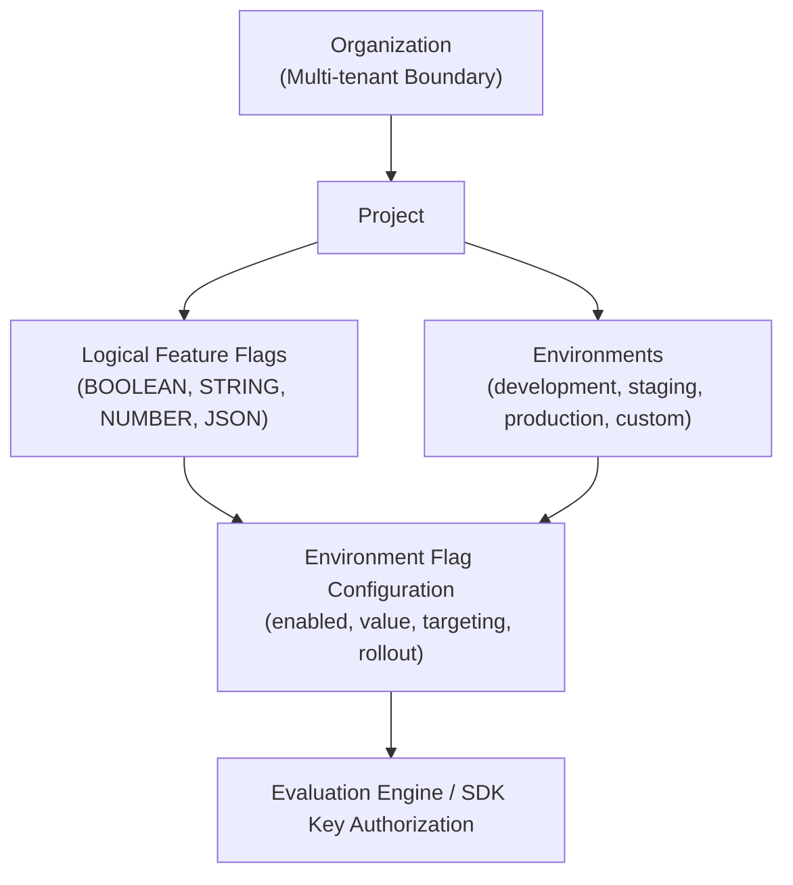

# Switchly

Switchly is a high-performance, multi-tenant feature flag management and remote configuration platform. It provides project-scoped logical flags with independent environment configurations, strictly typed values (`BOOLEAN`, `STRING`, `NUMBER`, `JSON`), granular targeting, and an evaluation engine with server-side SDK credential management.

The platform is built with **Java 21**, **Spring Boot 4**, **PostgreSQL 17**, **Flyway**, **React 19**, **TypeScript**, and **Docker Compose**.

---

For deployment, backup, recovery, release gates and verification evidence, use the [RC-1 deployment runbook](infra/DEPLOYMENT.md).

## Architecture & Hierarchy

Switchly enforces tenant isolation and cross-project consistency at both application and database engine levels:

$$\text{Organization} \longrightarrow \text{Project} \longrightarrow \begin{cases} \text{Environments} \ (\text{dev}, \text{staging}, \text{prod}, \text{custom}) \\ \text{Logical Flags} \ (\text{key}, \text{name}, \text{valueType}, \text{defaultValue}) \end{cases} \longrightarrow \text{Environment Configuration}$$



### Core Concepts

1. **Organization**: The top-level tenant boundary. Users belong to organizations with an organization-wide `ADMIN` role or a single-project `EMPLOYEE` assignment.
2. **Project**: Groups related features, configurations, and environments.
3. **Environment**: Isolated lifecycle stages (`development`, `staging`, `production`, plus custom environments).
4. **Logical Feature Flag**: Represents a feature's identity with a stable key (`^[a-z0-9-]+$`), human name, immutable `valueType`, and `defaultValue`.
5. **Environment Configuration**: An independent configuration per `(flag, environment)` pair holding `enabled` state and typed `value`. Changing development never impacts staging or production.
6. **Automatic Provisioning**:
   - Creating a flag automatically provisions configurations across all existing environments of the project.
   - Creating a custom environment automatically provisions configurations for all existing flags using their `defaultValue`.
7. **Database Referential Integrity**: Enforced via PostgreSQL composite foreign keys `(flag_id, project_id)` and `(environment_id, project_id)` to guarantee cross-project configurations cannot exist.

---

## Tech Stack

| Layer | Technology | Version | Purpose |
|---|---|---|---|
| **Backend Framework** | Spring Boot | 4.1.1 | Modular-monolith REST API, transaction management |
| **Language** | Java | 21 (LTS) | Modern Java runtime, virtual threads ready |
| **Database** | PostgreSQL | 17 | Relational persistence, JSONB typed values, composite FKs |
| **Schema Migrations** | Flyway | V1–V10 | Transactional, immutable, versioned database migrations |
| **JSON Serialization** | Jackson | 3.1.5 (`tools.jackson`) | Decoupled JSONB persistence & strict type validation |
| **Security** | Spring Security | 6.x | Stateless JWT, BCrypt-12, rate limiting, RBAC |
| **Frontend UI** | React / TypeScript | 19.2 / 5.9 | Reactive release console, lossless JSON parsing |
| **Frontend Gateway** | Node.js | 22+ / 24 | Same-origin session gateway, HttpOnly cookie management |
| **Build & Tooling** | Maven & Vite | 3.x / 7.x | Reproducible builds and hot-reload development |
| **Containers** | Docker & Compose | 29+ | Multi-stage production images, non-root UID 1001 |

---

## Quickstart: Run the Complete Stack

Start all services (PostgreSQL, Spring Boot API, and Web Console) with a single command:

```sh
# 1. Generate or supply a 256-bit JWT secret (64 hex characters)
export SWITCHLY_JWT_SECRET="$(openssl rand -hex 32)"

# 2. Build and start the stack in the background
docker compose -f infra/docker-compose.yml up --build -d

# 3. Verify health
curl --fail http://localhost:8080/healthz
```

### Access Points

| Service | Address | Description |
|---|---|---|
| **Web Console** | [http://localhost:3000](http://localhost:3000) | Full management UI (SPA + Session Gateway) |
| **REST API** | [http://localhost:8080](http://localhost:8080) | Spring Boot REST API & Evaluation Endpoints |
| **Health Probe** | [http://localhost:8080/healthz](http://localhost:8080/healthz) | Minimal public health check (`{"status":"UP"}`) |
| **PostgreSQL** | `localhost:15432` | Database (`switchly` / `switchly` / `switchly`) |

To stop the stack while preserving database volumes:
```sh
docker compose -f infra/docker-compose.yml down
```

---

## Local Development

### Backend (Spring Boot API)

Prerequisites: JDK 21+ and Docker Desktop (for Testcontainers).

```sh
cd api

# Run unit tests and in-memory suites
./mvnw test -Dtest="*Test,!*PostgresTest,!*IntegrationTest"

# Run full test suite with PostgreSQL Testcontainers
DOCKER_HOST=unix://$HOME/.docker/run/docker.sock ./mvnw test

# Run the API locally with in-memory profile (no database required)
./mvnw spring-boot:run -Dspring-boot.run.profiles=in-memory
```

### Frontend (React 19 Console)

Prerequisites: Node.js 22.12+.

```sh
cd web

# Install dependencies
npm ci

# Run unit test suite
npm test

# Start development server with Vite hot reload (proxies to backend on 8080)
PORT=3000 npm run dev
```

---

## Feature Flags & Typed Values

Switchly supports 4 strongly typed flag configurations with strict type validation:

| Value Type | Allowed JSON Types | Default Value | Example Payload |
|---|---|---|---|
| `BOOLEAN` | Boolean (`true`, `false`) | `false` | `{"value": true}` |
| `STRING` | Text string | `""` | `{"value": "modern-v2"}` |
| `NUMBER` | Integer, Long, Float, Double | `0` | `{"value": 1500}` |
| `JSON` | Valid JSON Object or Array | `{}` | `{"value": {"rateLimit": 500, "cache": true}}` |

- **Type Immutability**: A logical flag's `valueType` is immutable after creation.
- **Strict Validation**: Type mismatches are rejected with HTTP `400 Bad Request` (no silent type coercion).
- **Default Value Semantics**: Updating a logical flag's `defaultValue` only applies to newly created environments; existing environment configurations are preserved.

---

## API Summary (Key Endpoints)

All endpoints are prefixed with `/api/v1` (except the public `/healthz` probe).

### Authentication & User
- `POST /auth/register` — Register new user, organization, and ADMIN membership
- `POST /auth/login` — Authenticate and receive access + refresh token
- `POST /auth/refresh` — Single-use refresh token rotation with family reuse revocation
- `POST /auth/logout` — Revoke the presented refresh token
- `GET, PUT /auth/me` — Read or update user profile

### Organizations & RBAC
- `GET, POST /orgs` — Read the active workspace or create a separate organization as an admin
- `GET /orgs/{orgId}` — Inspect organization details
- `GET /orgs/{orgId}/members` — Admins see the organization roster. Employees see their own membership.
- `POST /orgs/{orgId}/members/invitations` — Invite an admin or assign an employee to one project.
- `PUT /orgs/{orgId}/members/{userId}/role` — Update member role (last-admin demotion protected)
- `DELETE /orgs/{orgId}/members/{userId}` — Remove member (last-admin removal protected)

### Projects & Environments
- `GET, POST /orgs/{orgId}/projects` — List or create projects (auto-provisions `dev`, `staging`, `prod`)
- `GET /projects/{projectId}` — Read project details
- `GET, POST /projects/{projectId}/environments` — List or create custom environments (auto-provisions flags)
- `GET, PUT, DELETE /environments/{environmentId}` — Inspect, rename, or delete environment

### Logical Feature Flags (Project-Scoped)
- `GET, POST /projects/{projectId}/flags` — List flags or create a typed logical flag
- `GET /flags/{flagId}` — Read flag details
- `PUT /flags/{flagId}` — Update name, description, or `defaultValue`
- `DELETE /flags/{flagId}` — Delete logical flag and cascade all environment configurations
- `PUT /flags/{flagId}/state` — **Deprecated** (returns `400 Bad Request` with `code: DEPRECATED_ENDPOINT`)

### Environment Flag Configurations (Environment-Scoped)
- `GET /environments/{environmentId}/flags` — List all flag configurations for an environment
- `GET /environments/{environmentId}/flags/{flagId}` — Read single flag configuration
- `PUT /environments/{environmentId}/flags/{flagId}/state` — Toggle `enabled` state in environment
- `PUT /environments/{environmentId}/flags/{flagId}/value` — Update typed `value` in environment

Detailed documentation of all endpoints and request/response payloads is available in [switchly-api-docs.md](api/switchly-api-docs.md).

---

## Security Architecture

1. **Authentication**: Stateless HMAC-SHA256 JWT access tokens (15-minute expiration) paired with cryptographically secure 256-bit refresh tokens (7-day expiration).
2. **Refresh Token Rotation & Reuse Detection**: Refresh tokens are single-use. If a previously consumed token is presented, the entire family is immediately revoked to mitigate stolen-token replay attacks.
3. **Password Hashing**: BCrypt with work factor 12.
4. **Tenant Isolation**: RBAC and cross-tenant boundaries enforced on every request by `TenantAuthorizationService`.
5. **Rate Limiting**: Token-bucket filter protects public authentication endpoints (`/login`, `/register`, `/refresh`) per IP address.
6. **Container Security**: Backend container runs as unprivileged user `switchly` (UID 1001).
7. **Forwarded Headers & HSTS**: RFC 7239 / `X-Forwarded-*` headers handled only from trusted proxies; HSTS header strictly restricted to HTTPS requests.

---

## Testing & Quality Assurance

- **Backend**: **254 automated tests** (100% passing) spanning unit models, services, concurrency, Spring Security, Flyway schema validation, and PostgreSQL 17 Testcontainers integration.
- **Frontend**: **10 Node test suites** covering lossless JSON serialization, session cookie lifecycle, and API gateway routing, backed by Playwright end-to-end tests.
- **Rollback Assurance**: Database tests use real PostgreSQL triggers to verify that failures during multi-table provisioning roll back completely with zero orphan rows.
